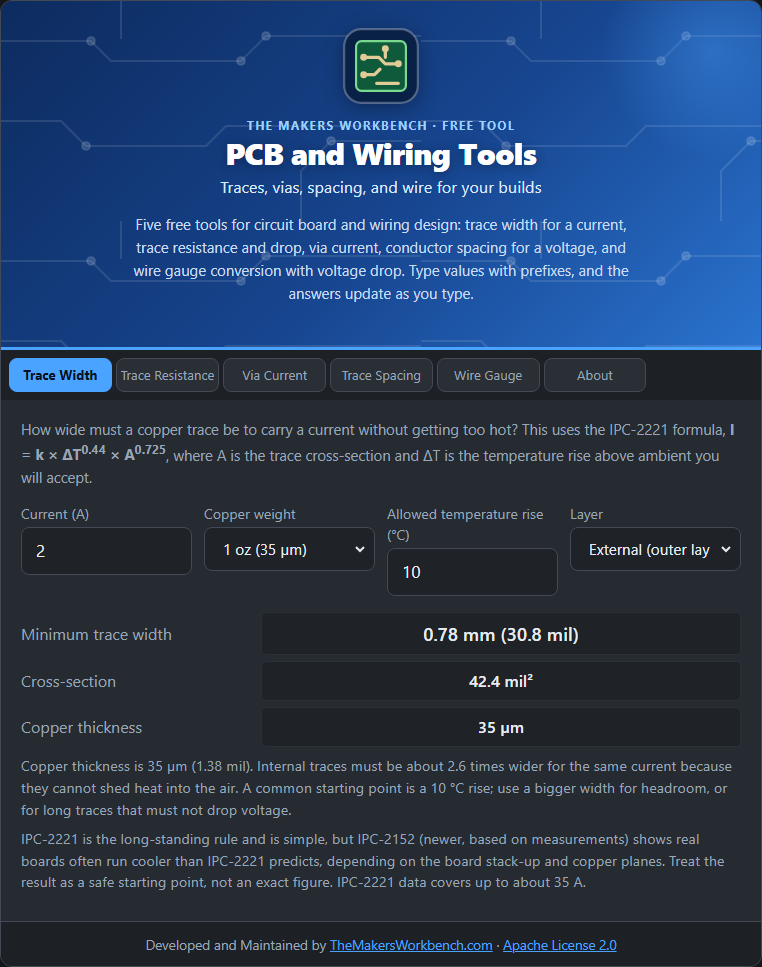

# PCB and Wiring Tools

Free tools for circuit board and wiring design, by [TheMakersWorkbench.com](https://www.themakersworkbench.com). five tools, one page, nothing to install.

## Start here

- [Using the Tools](Using-the-Tools): typing values, prefixes, and how the answers update

## The tools

Each page explains the theory, gives the formulas, shows how to use the tab step by step, and walks through a worked example.

- [Trace Width](Trace-Width)
- [Trace Resistance](Trace-Resistance)
- [Via Current](Via-Current)
- [Trace Spacing](Trace-Spacing)
- [Wire Gauge](Wire-Gauge)

## For developers

- [Embedding](Embedding)
- [Accuracy and Limits](Accuracy-and-Limits)

## Quick links

- [Source code and issues](https://github.com/MakersWorkbench/pcb-wiring)
- [SOURCES.md](https://github.com/MakersWorkbench/pcb-wiring/blob/main/SOURCES.md)
- License: [Apache 2.0](https://github.com/MakersWorkbench/pcb-wiring/blob/main/LICENSE)
