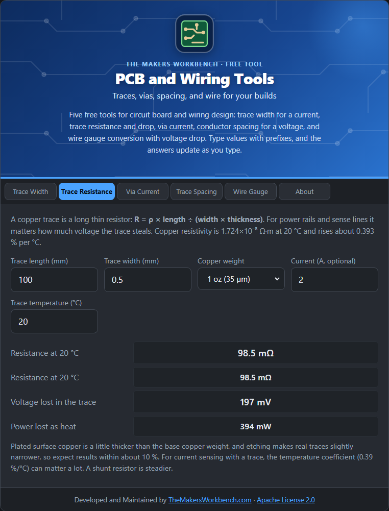

# Trace Resistance

A copper trace is a long thin resistor. On a power rail or a sense line, its resistance steals voltage and wastes power as heat.

## The theory

Resistance follows the same rule as any conductor:

**R = ρ × length ÷ (width × thickness)**

where ρ (rho) is copper's resistivity, **1.724 × 10⁻⁸ Ω·m at 20 °C**. Copper resistance also rises with temperature, about **0.393 % per °C**: **R(T) = R20 × (1 + 0.00393 × (T − 20))**.

Voltage lost is **I × R** and the heat made is **I² × R**.

## Step by step

1. Open the **Trace Resistance** tab.
2. In **Trace length (mm)** and **Trace width (mm)**, type the dimensions, for example `100` and `0.5`.
3. In **Copper weight**, choose your board's copper (1 oz is about 35 µm).
4. In **Current (A, optional)**, type the current to see the voltage drop and heat.
5. In **Trace temperature (°C)**, type the temperature if it is not 20 °C.
6. Read the **resistance**, the **voltage lost**, and the **power lost**.

## Worked example

A 100 mm long, 0.5 mm wide, 1 oz trace has **98.5 mΩ**. At 2 A it drops **0.20 V** and wastes **0.39 W**. If the board runs at 100 °C, the resistance rises by about 31 %.

## Things to watch

- Real traces are slightly narrower than drawn after etching, and plated outer layers are slightly thicker than the base copper, so expect about 10 % difference.
- Using a trace as a current sensor is possible, but its temperature coefficient (0.39 %/°C) makes it drift. A shunt resistor is steadier.

