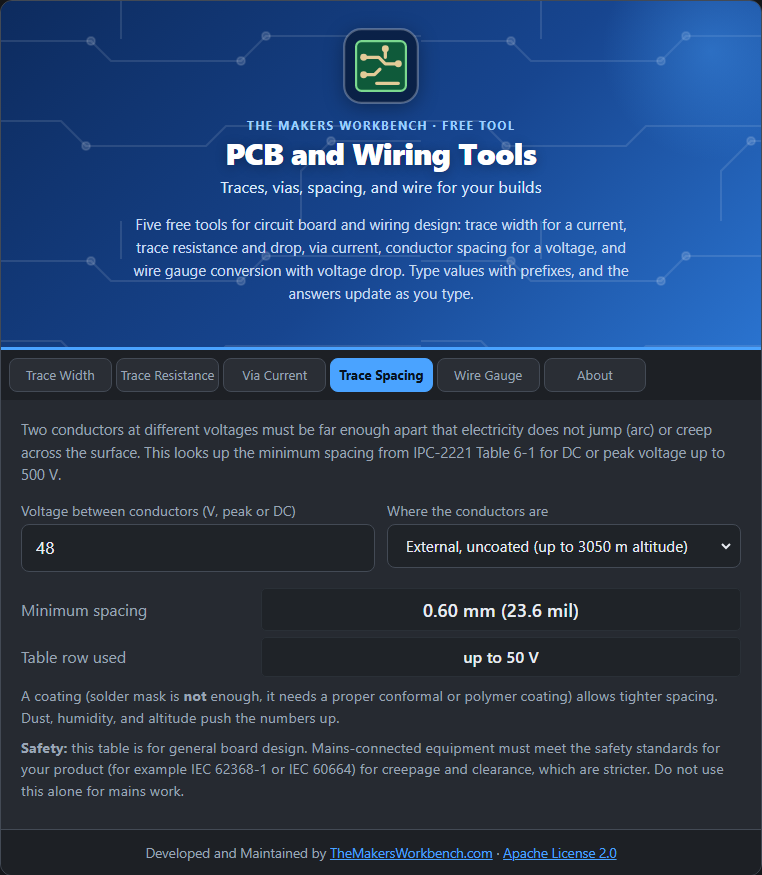

# Trace Spacing

Two conductors at different voltages must be far enough apart that electricity cannot jump the gap (**arcing**) or creep across the board's surface (**tracking**). This tool looks up the minimum spacing for a voltage.

## The theory

IPC-2221 Table 6-1 gives minimum spacings between conductors for voltages up to 500 V (DC or peak). The distance depends on where the conductors are:

- **Internal layers** are sealed inside the board, so they can be close together.
- **External, uncoated** conductors face the air, dust, and moisture, so need much more room.
- **External with a permanent polymer coating** (a conformal coating, not just solder mask) can sit closer than bare conductors.

Altitude, pollution, and humidity all push the numbers up. The table values are for general use at up to about 3050 m altitude.

## Step by step

1. Open the **Trace Spacing** tab.
2. In **Voltage between conductors (V, peak or DC)**, type the highest voltage difference between the two traces, for example `48`.
3. In **Where the conductors are**, choose the layer and coating.
4. Read **Minimum spacing** in mm and mil, and the table row used.

## Worked example

At **48 V**, the minimum spacing is **0.1 mm** on an internal layer, **0.6 mm** on an uncoated outer layer, and **0.13 mm** on an outer layer with a polymer coating.

## Things to watch

- **Safety.** This table is for general board design. Mains-connected equipment must meet the safety standards for your product (for example IEC 62368-1 and IEC 60664 for creepage and clearance), which are stricter. Do not use this alone for mains work.
- Solder mask is not a coating for this purpose.
- Above 500 V, this table does not apply. Use the standards.

