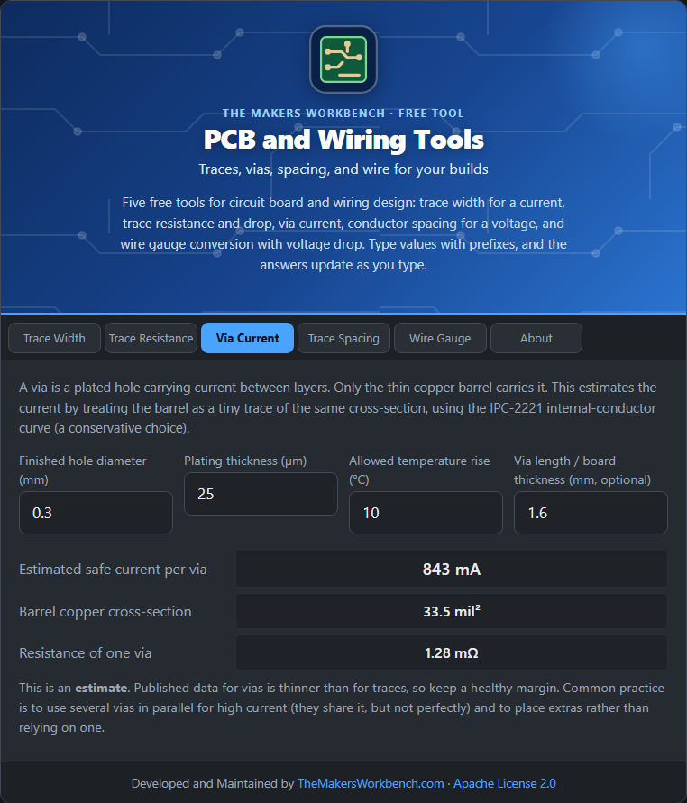

# Via Current

A **via** is a plated hole that carries a signal or current between layers. Only the thin copper barrel inside the hole carries it, so vias are often the weak point of a high-current path.

## The theory

The barrel is a thin copper tube. Its cross-section is the area between the outer and inner circles:

**area = π ÷ 4 × (D² − (D − 2t)²)**

where D is the finished hole diameter and t is the plating thickness. This tool then treats the barrel like a small trace of that cross-section and applies the IPC-2221 **internal** conductor curve (a conservative choice):

**I = 0.024 × ΔT^0.44 × area^0.725** (area in square mils)

The resistance of the barrel is **ρ × length ÷ area**, with the length equal to the board thickness.

## Step by step

1. Open the **Via Current** tab.
2. In **Finished hole diameter (mm)**, type the via size, for example `0.3`.
3. In **Plating thickness (µm)**, type it. 25 µm (about 1 mil) is typical.
4. In **Allowed temperature rise (°C)**, type your limit, for example `10`.
5. In **Via length / board thickness (mm, optional)**, type the board thickness, for example `1.6`, to see the via's resistance.
6. Read **Estimated safe current per via** and **Resistance of one via**.

## Worked example

A 0.3 mm via with 25 µm plating and a 10 °C rise carries about **0.84 A**, and across a 1.6 mm board it has about **1.3 mΩ**.

## Things to watch

- This is an **estimate**. Published data on vias is thinner than for traces, so keep a healthy margin.
- Use **several vias in parallel** for high current. They share the load, but not perfectly, so do not rely on the exact sum.
- Place vias close to the pad or plane they connect, and give them enough copper around them.

