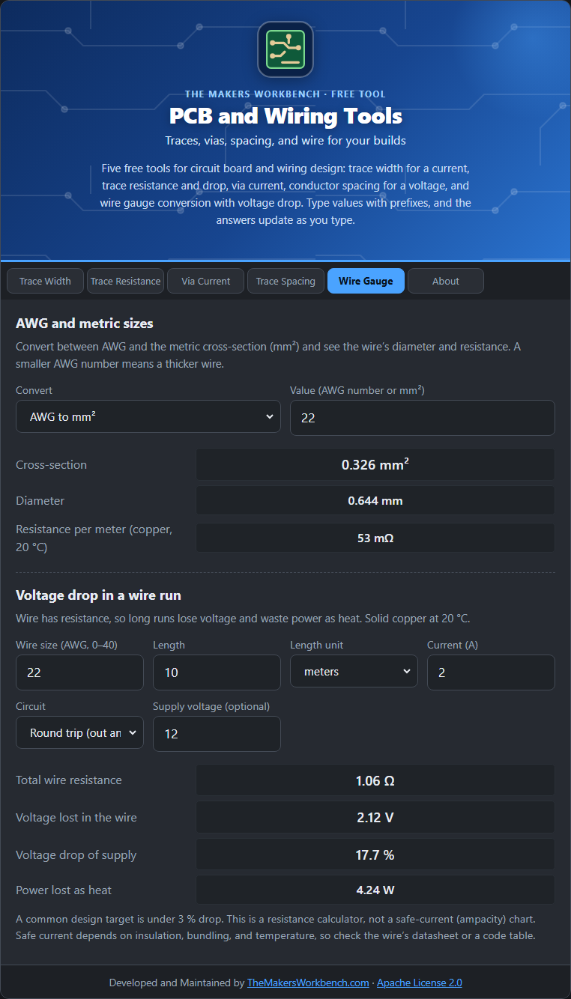

# Wire Gauge

**AWG** (American Wire Gauge) is the common wire-size system in electronics. The number gets **smaller as the wire gets thicker**. Metric wire is sold by cross-section in square millimeters. This tab converts between them and shows what a run of wire costs in voltage.

## The theory

AWG sizes follow a formula (ASTM B258): **diameter (mm) = 0.127 × 92^((36 − n) ÷ 39)**. Each step down in number makes the wire about 12 % thicker, and every 3 steps roughly halves the resistance. Cross-section is **π ÷ 4 × diameter²**.

Wire resistance follows **R = ρ × L ÷ A**, with copper's ρ equal to 1.724 × 10⁻⁸ Ω·m at 20 °C. Voltage drop is **I × R**, and the heat made is **I² × R**.

## Step by step: converting sizes

1. Open the **Wire Gauge** tab. The first block is **AWG and metric sizes**.
2. In **Convert**, choose **AWG to mm²** or **mm² to AWG**.
3. In **Value**, type the AWG number (for example `22`) or the cross-section (for example `0.5`).
4. Read the **cross-section** or **nearest AWG**, plus the diameter and resistance per meter.

## Step by step: voltage drop

1. In the second block, **Voltage drop in a wire run**, type the **Wire size (AWG, 0–40)**.
2. In **Length** and **Length unit**, type how long the run is (one side only).
3. In **Current (A)**, type the load current.
4. In **Circuit**, choose **Round trip (out and back)** for a normal two-wire supply, or **One way only**.
5. In **Supply voltage (optional)**, type the supply to see the loss as a percentage.
6. Read **Voltage lost in the wire**, **Voltage drop of supply**, and **Power lost as heat**. A common target is under 3 %.

## Worked example

**22 AWG** is **0.326 mm²** with a diameter of **0.644 mm** and about **53 mΩ per meter**. A 12 V device drawing 2 A through 10 m of 22 AWG (20 m of wire round trip) loses **2.1 V, 17.6 %** of the supply, which is too much. 16 AWG cuts that to about 4.4 %.

## Things to watch

- This is a resistance calculator, not an ampacity chart. How much current a wire can safely carry depends on insulation, bundling, and temperature. Check the wire's datasheet or an electrical code table.
- Stranded wire has slightly more resistance than solid wire of the same gauge.

